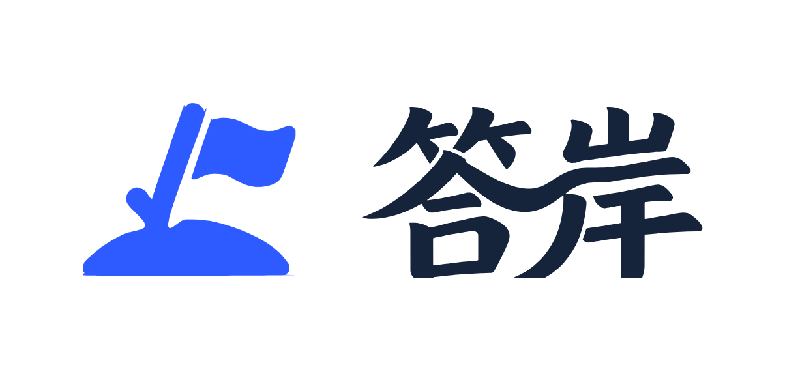

<p align="center"></p>

# 贡献指南（Contributing）

感谢你愿意为「答岸」贡献代码、文档或反馈。以下是参与方式。

## 前置要求

| 部分 | 技术栈 | 依赖 |
| --- | --- | --- |
| `backend/` | Python 3.12 · FastAPI · SQLite | `pip install -r backend/requirements.txt` |
| `frontend-uni/` | uni-app (Vue 3) · TypeScript · Vitest | Node 20+，`cd frontend-uni && npm install` |
| `miniapp-native/` | 微信小程序原生 TS | 微信开发者工具，`cd miniapp-native && npm install` |
| `landing/` | 纯静态 HTML/CSS/JS | 无构建 |

## 本地运行

```bash
# 后端（需要 OpenAI 兼容的 LLM 接口，AI 功能才会工作）
cd backend
pip install -r requirements.txt
export LLM_BASE_URL=...   # 例如 https://api.deepseek.com
export LLM_API_KEY=...
export LLM_MODEL=deepseek-chat
uvicorn app.main:app --reload --port 8000

# 前端（另开终端）
cd frontend-uni
npm install
npm run dev:h5   # http://localhost:5173，代理到本地或线上 API
```

## 测试（提交前必跑）

```bash
cd frontend-uni && npm test        # Vitest 单元/源锁测试
cd frontend-uni && npm run lint    # eslint + 设计 token 检查
cd backend && python -m pytest tests/   # 后端测试
```

## 提交与 PR 流程

1. 从 `main` 切分支：`git checkout -b <topic>-<一句话>`（如 `fix-stats-badge`）。
2. 提交信息用中文一句话说明「做了什么 + 为什么」，可带模块前缀（`stats:` `api:` `docs:`）。
3. 打开 Pull Request，按模板填写：动机、改动、验证方式（附截图或测试输出）。
4. 小步提交、专注单一主题；功能改动请附/更新对应测试。
5. CI 与人工 review 通过后由维护者 squash 合并。

## 代码约定

- 前端：组件样式统一走 `zalize-tokens` 设计变量（`src/static/brand/`），不引入新的硬编码色值；
  文案/布局变更尽量带 Vitest 源锁测试。
- 后端：新接口按业务域放进 `app/db_*.py` / `app/*_api.py`；数据库结构变更走 Alembic 迁移。
- 不提交密钥、`.env`、`data.db`、构建产物（`dist/`、`node_modules/`）。
- 题目语料、真题内容来自公开渠道整理，请勿提交任何受版权保护的付费课程内容。

## 反馈与讨论

- Bug 与功能建议：GitHub Issues（按模板选 bug / feature）。
- 产品内测反馈：https://kaogong.zalize.com/#feedback

行为准则见 [CODE_OF_CONDUCT.md](CODE_OF_CONDUCT.md)。
