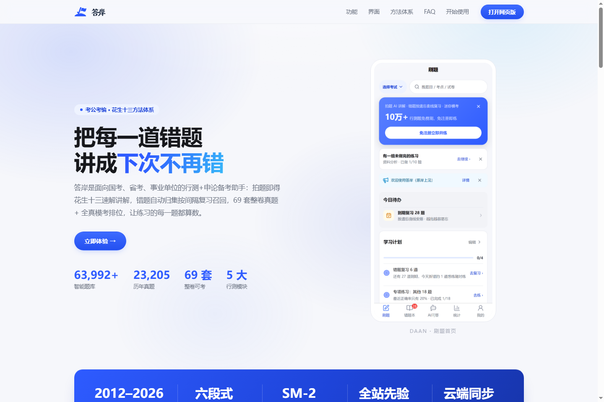

<p align="center">
  
</p>

<h3 align="center">AI 考公刷题与错题助手 · 花生十三方法体系</h3>

<p align="center">
  AI-powered practice &amp; mistake-book assistant for China's civil service exam (公务员考试 / 行测 / 申论)。
</p>

<p align="center">
  <a href="https://kaogong.zalize.com/">官网</a> ·
  <a href="https://kaogong.zalize.com/app/">网页版（打开即用）</a> ·
  微信小程序（内测中） ·
  <a href="https://kaogong.zalize.com/#feedback">内测反馈</a>
</p>

<p align="center">
  <a href="LICENSE"></a>
  
  
  
</p>

<p align="center">
  
</p>

面向公务员考试备考者的错题讲解与刷题工具：上传错题截图或粘贴题目，AI 按「花生十三」公开教学
体系的方法（ABRX、截位直除、415 份数、假设分配、翻译推理等）分步讲解、分析错因，存入错题本
做间隔复习与薄弱点统计；同时提供五大模块题库、真题卷、每周模考大赛与申论批改。

## ✨ 功能特性

- 📷 **拍照/截图识题**：多模态 LLM 直接读图，无需独立 OCR 管线
- 🧭 **题型路由**：自动判断模块（资料分析/数量关系/言语/判断/常识/申论）并加载对应方法库
- 📖 **方法库严格引用**：只讲方法库里有的技巧，没有就明说，不编造「花生十三方法」
- ❌ **六段式讲解 + 错因分析**：判答案 / 点方法 / 拆步骤 / 防陷阱 / 给迁移 / 练同类
- 📒 **错题本**：SM-2 间隔复习、题型聚合、定向重练、手工录入与导出错题本
- 📊 **学习统计**：难度画像、掌握度图谱、学习日历打卡、击败百分比
- 📝 **题库刷题**：五大模块题库（真题/三级考点/同材料题组/自适应难度）、约 196 套真题卷、
  每周六全站同卷模考大赛
- 📄 **申论**：真题题库 + 素材范文、AI 采分点批改、作答历史、草稿自动保存
- 🛠 **管理后台 `/admin`**：数据看板、AI 通道健康监测、题库管理、批次审核、用户纠错、公告
- 🌐 **平台**：网页版已上线；微信小程序内测中（同账号数据互通）

## 🏗 架构

```
浏览器 / 微信小程序
        │
Cloudflare Pages + Functions（静态层 + 同源代理）
        │  Cloudflare Tunnel
        ▼
FastAPI (uvicorn) + SQLite            ← backend/
   ├─ app/*_api.py      按业务域拆分的 API
   ├─ app/db_*.py       数据访问层 + Alembic 迁移
   ├─ app/llm.py        OpenAI 兼容 LLM 客户端（多通道/救援模型）
   ├─ app/seo.py        /tiku/ SSR 题库落地页 + sitemap
   └─ app/admin/        管理后台
uni-app (Vue3) → H5                   ← frontend-uni/
微信小程序（原生 TS）                  ← miniapp-native/
官网落地页（纯静态）                   ← landing/
花生十三方法库 / 题库数据              ← knowledge/ + data/ + qimg/
```

## 🚀 快速开始

需要：Python 3.12+、Node 20+。

```bash
# 1. 后端
cd backend
pip install -r requirements.txt
export LLM_BASE_URL=https://api.deepseek.com   # 任意 OpenAI 兼容接口
export LLM_API_KEY=sk-...
export LLM_MODEL=deepseek-chat                  # 识图功能需多模态模型
uvicorn app.main:app --reload --port 8000
# → http://localhost:8000（自动建库、写入种子题库）

# 2. 前端（另开终端）
cd frontend-uni
npm install
npm run dev:h5
# → http://localhost:5173
```

生产部署（Docker / Cloudflare Pages + Tunnel）见 [deploy/README.md](deploy/README.md)。

## 🧪 测试

```bash
cd frontend-uni && npm test          # Vitest（含组件行为与「源锁」回归测试）
cd frontend-uni && npm run lint      # eslint + 设计 token lint
cd backend && python -m pytest tests/    # 后端 pytest
```

## 📁 目录结构

```
backend/           FastAPI 后端 + SQLite；app/ 按业务域拆分，alembic/ 迁移
frontend-uni/      uni-app 源码 → 编译为网页版 H5（/app/）
miniapp-native/    微信小程序源码（原生 TypeScript，内测中）
landing/           官网落地页（纯静态单页 + lp-assets 品牌素材）
knowledge/         花生十三方法库 + 复盘流程知识库
data/              题库语料与审计账本（清洗脚本见 scripts/ 与 backend/scripts/）
qimg/              题目配图（由 /qimg/* 接口直出）
docs/              设计系统、架构文档、QA 报告（docs/qa/）、迭代簿记（docs/iter/）
tools/             设计 token 构建、API 类型生成、冒烟检查等开发工具
scripts/           运维脚本（一次性修复脚本在 scripts/one-off/）
deploy/            Dockerfile.runtime、docker-compose、CF Pages functions、部署脚本
eval/              LLM 讲解质量评测集
.github/           PR / Issue 模板
```

## 📚 方法库与题目版权

- `knowledge/references/` 来自开源项目
  [WangJunqing-coder/huasheng13-skill](https://github.com/WangJunqing-coder/huasheng13-skill)
  （README 声明 MIT），基于花生十三**公开教学渠道**（B 站公开课、知乎专栏等）整理，
  不含付费课程原文。本项目不复制、不传播任何付费课程内容。
- 题库主要来自开源「上岸通」语料及粉笔题库镜像/网友回忆版真题，仅供个人学习辅助使用；
  如涉及版权问题请开 Issue 联系下架。

## 🤝 贡献

欢迎 Issue、PR 与产品反馈。开始前请阅读
[贡献指南](CONTRIBUTING.md) 与 [行为准则](CODE_OF_CONDUCT.md)。
产品内测反馈入口：https://kaogong.zalize.com/#feedback

## 📄 许可证

代码以 [MIT License](LICENSE) 发布。`knowledge/references/` 内容随其上游项目许可证；
题目语料版权归原出卷机构/整理方所有，仅用于学习研究。
