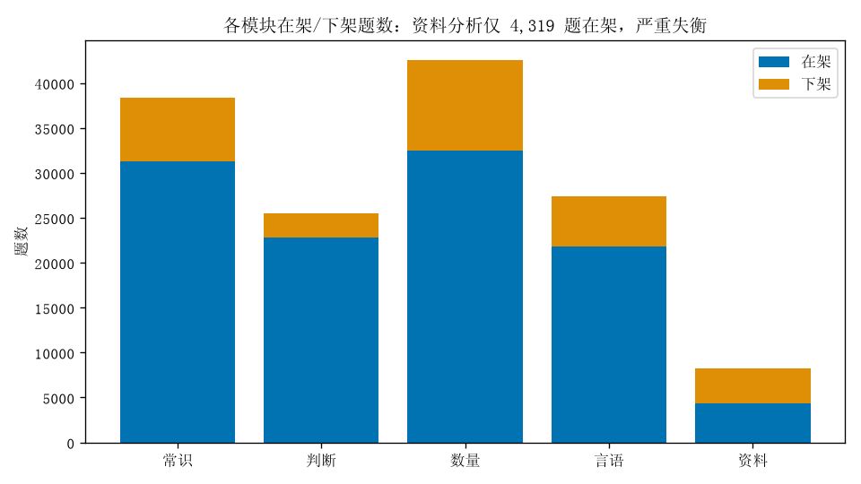
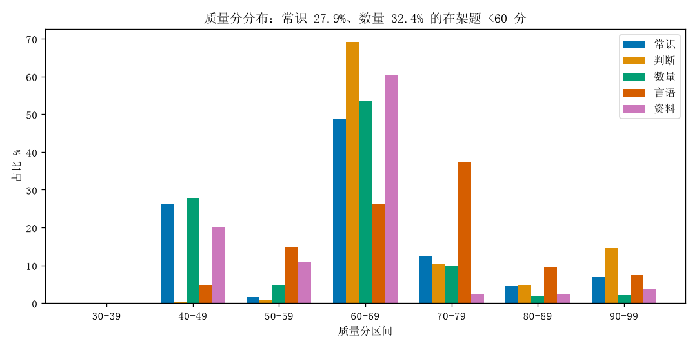
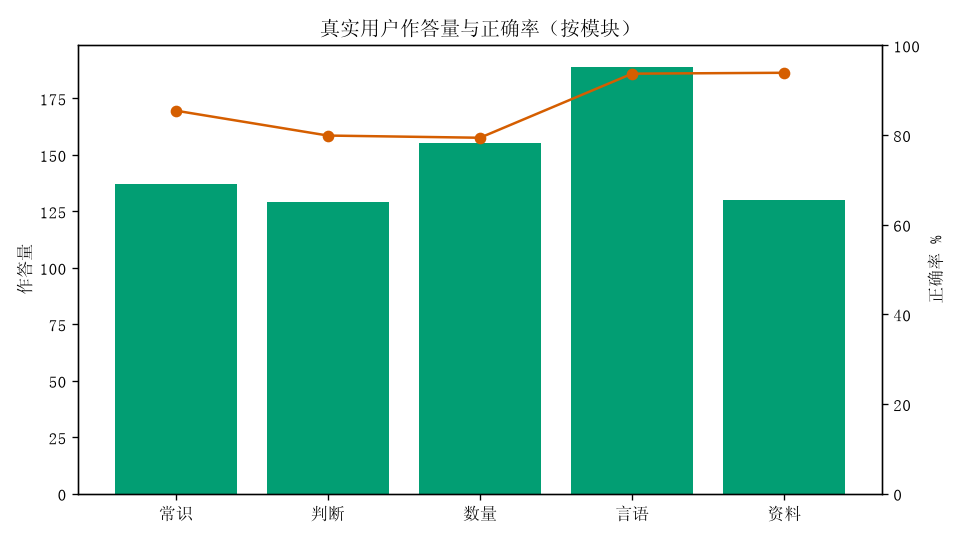
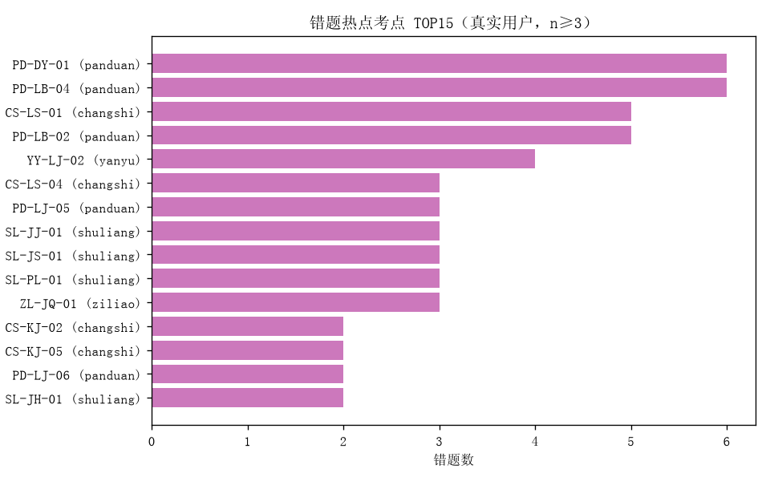
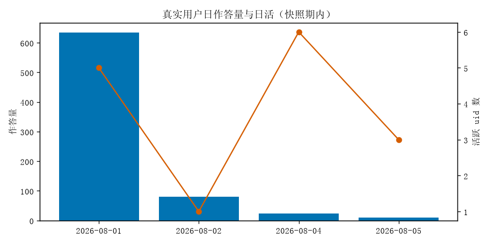

# 数据分析报告 · Round 1

- 数据源：生产库快照 `snap_iter.db`（2026-08-05，只读分析）
- 分析口径：除特别说明外，「在架」= `disabled=0`；「真实用户」= `uid LIKE 'ums%'`（排除 r68*/r81*/r88b*/opponent*/smoke 等测试 uid，测试流量占 answer_log 的 35.7%，414/1161 条）

---

## 1. 题库健康看板

### 1.1 各模块在架/下架题数

| 模块 | 在架 | 下架 | AI 生成占比（在架，is_real=0） |
|---|---|---|---|
| 常识 changshi | 31,238 | 7,139 | 88.0% |
| 判断 panduan | 22,786 | 2,699 | 78.2% |
| 数量 shuliang | 32,509 | 10,084 | 94.4% |
| 言语 yanyu | 21,780 | 5,610 | 79.2% |
| 资料 ziliao | **4,319** | 3,880 | 93.4% |
| 合计 | 112,632 | 29,412 | — |

**资料分析严重失衡**：在架仅 4,319 题，为其他模块的 1/5～1/7，且下架率高达 47.3%（3,880/8,199）——远高于其他模块（判断 10.6%、常识 18.6%）。而真实用户对资料模块作答需求并不低（作答量 130 条，与常识/判断相当）。

### 1.2 tag3 覆盖与 UNKNOWN 残量

在架题 tag3 覆盖率 **99.998%**，仅剩 2 题 UNKNOWN（均在言语模块），无空值。tag3 治理基本完成。

各模块 tag3 数量：常识 33、判断 22、数量 56、言语 19、资料 27。

但 **submodule 空值残留明显**：常识 7,935 题（25.4%）、数量 7,455 题（22.9%）submodule 为空。推荐引擎 `recommend_stats` 明确过滤 `submodule IS NULL OR =''` 的作答记录，这部分题的作答会直接从弱项分析中丢失。

### 1.3 质量分分布

| 模块 | <50 分 | <60 分 | <60 占比 |
|---|---|---|---|
| 常识 | 8,229 | 8,709 | 27.9% |
| 判断 | 61 | 243 | 1.1% |
| 数量 | 8,983 | 10,518 | 32.4% |
| 言语 | 1,001 | 4,257 | 19.5% |
| 资料 | 869 | 1,342 | 31.1% |

常识和数量存在明显的 40-49 分「低分簇」（常识 8,228 题、数量 8,983 题），几乎全部 <50 分的题集中在该区间，疑似同批次生成/导入的题。判断模块质量最好（99% ≥60 分）。

### 1.4 低分题 TOP

全库最低 15 题全部为**常识-历史人文** AI 生成题（37-40 分），存在统一的格式问题（嵌套引号 `“'…'”`），如：

- id 568091（37 分）：`'停车坐爱枫林晚…'的作者是：`
- id 488595（40 分）：`三国“'官渡之战'”曹操火烧的粮仓地点是：`
- id 488597（40 分）：`东晋“'兰亭集序'”书写使用的字体是：`

提示低分主因之一是**文本格式噪声**，可批量清洗后重打分，而非逐题人工修。

### 1.5 图片引用健康

在架带图题 216 题，全部为相对路径 `/qimg/*.png`（无外链、无 data URI）。随机抽样 20 个 URL 在生产站 HEAD 校验 **20/20 返回 200**，图片引用健康。另有 34 题带图题已下架。

### 1.6 重复簇残余

`dup_clusters` 共 11,920 行：`resolved` 9,262、`not_dup` 2,658，**无 pending 残留**，去重治理已收敛。

---

## 2. 作答数据分析

### 2.1 作答量与正确率（真实用户，747 条）

| 模块 | 作答量 | 正确率 |
|---|---|---|
| 言语 | 189 | 93.7% |
| 数量 | 155 | 79.4% |
| 常识 | 137 | 85.4% |
| 资料 | 130 | 93.8% |
| 判断 | 129 | 79.8% |
| 时政 | 7 | **28.6%** |

注意：747 条中 595 条（80%）来自单一用户 `umsa00d6…`（正确率 95.1%），整体正确率被其拉高，样本代表性有限。时政模块正确率异常低（28.6%），但样本仅 7 条。

### 2.2 错题热点考点 TOP（n≥3）

| tag3 | 考点名 | 作答 | 错题 | 错误率 |
|---|---|---|---|---|
| PD-DY-01 | 单定义 | 25 | 6 | 24% |
| PD-LB-04 | 对应关系 | 30 | 6 | 20% |
| CS-LS-01 | 中国古代史 | 16 | 5 | 31% |
| PD-LB-02 | 逻辑关系 | 8 | 5 | **63%** |
| YY-LJ-02 | 成语辨析 | 32 | 4 | 13% |
| CS-LS-04 | 文学艺术 | 14 | 3 | 21% |
| PD-LJ-05 | 加强论证 | 11 | 3 | 27% |
| SL-JS-01 | 基础代数计算 | 7 | 3 | **43%** |
| SL-PL-01 | 基础排列组合 | 10 | 3 | 30% |
| ZL-JQ-01 | 基期量计算 | 9 | 3 | 33% |

判断模块的类比推理（PD-LB-02 逻辑关系 63%、PD-LB-04 对应关系）是最集中的错误热点；错题热点与低质量分模块（常识历史人文 CS-LS-01/04）有重叠，需人工核查这些考点的题目答案/解析是否本身有误。

### 2.3 模考完成率

exam_attempts 共 6 次，提交 2 次，**完成率 33%**；已完成的 2 次得分仅 6.7 和 3.3 分。弃考率高 + 得分极低，提示模考体验（时长、难度、中断恢复）可能有问题，样本太小需持续观察。

### 2.4 用户活跃与留存（粗算）

快照期内（8/1–8/5）有作答的真实 uid 共 **14 个**，其中仅 **1 个**出现 ≥2 天（次日留存 ≈7%）。8/4 日活 6 人为峰值，但人均作答不足 4 题——大部分用户浅尝即走。

### 2.5 错题本数据质量

`mistakes` 102 条中 **64 条（63%）`question_id` 为空**，无法 join questions 取 tag3，导致这部分错题无法参与考点级弱项分析与推荐。

---

## 3. 推荐与练习效果：推荐 vs 实际错题匹配度

方法：对 4 个作答量 ≥20 的真实用户，用前 70% 作答离线重放 `recommend_stats` 评分逻辑生成 Top-4 弱项推荐，检验后 30% 作答中的错题是否落在推荐考点（tag3 或 module+submodule 命中均算命中）。

| uid | 作答量 | 留出集错题 | 命中 |
|---|---|---|---|
| umsa00d6… | 571 | 5 | 1 |
| umsacie7… | 59 | 3 | 1 |
| umsafoov… | 25 | 5 | 0 |
| umsafpah… | 25 | 2 | 0 |
| 合计 | — | 15 | **2（13%）** |

匹配度偏低的结构性原因：

1. **tag3 粒度推荐几乎不可用**：`TAG3_MIN_N=5` 要求同考点 ≥5 次作答才单独成项，普通用户作答量（中位数 ~5 题）远达不到，推荐几乎全部回退到二级题型粒度。
2. **submodule 空值题的作答被直接丢弃**（见 1.2），常识/数量约 1/4 的题作答不进弱项统计。
3. 遗忘/考频权重占 35%，对低作答量用户来说噪声大于信号。

---

## 4. 数据驱动的改进点（P0/P1/P2）

### P0-1 补足资料分析题量并降低其下架率
在架仅 4,319 题（其他模块的 1/5），下架率 47.3% 全库最高，而真实用户作答需求与常识/判断相当。建议本轮补题方向优先资料分析（现期量/基期量/增长率等作答热点考点），并复查其高下架率原因（是导入质量问题还是误杀）。

### P0-2 修复 mistakes 表 question_id 缺失（63%）
64/102 条错题无 question_id，无法取 tag3，错题本的考点级分析和「查漏补缺」推荐直接失效。需排查写入路径（手动录入/旧版本端未带 qid），对存量可用 question_text 模糊回填。

### P1-1 批量清洗常识/数量 40-49 分低分簇（约 1.7 万题）
低分题高度集中且格式问题统一（嵌套引号等文本噪声），先批量文本清洗→重打分，预计可显著消化 <60 分存量（常识 27.9%、数量 32.4%）；清洗后仍 <50 分的再走人工审核/下架。

### P1-2 回填 submodule 空值（常识 25.4%、数量 22.9%）
tag3 覆盖已达 99.998%，可直接按 tag3→所属二级题型映射批量回填 submodule，使这部分作答进入 `recommend_stats` 弱项统计（当前被 `submodule!=''` 过滤丢弃）。

### P2-1 降低推荐冷启动门槛
离线重放显示 Top-4 推荐对留出集错题命中率仅 13%。建议：作答量 <30 时降 `TAG3_MIN_N`（5→3）并下调遗忘/考频权重，优先按「实际错过的考点」推荐；错题热点（类比推理 PD-LB-02/04、单定义 PD-DY-01）可作为新用户默认弱项种子。

### P2-2 核查错误率异常考点的题目质量
PD-LB-02 逻辑关系错误率 63%、SL-JS-01 基础代数 43%、时政 7 答仅 2 对——错误率显著偏离模块均值时，先人工抽查这些考点题目的答案与解析是否本身有误，再归因于用户水平。

---

## 附：图表清单

| 文件 | 内容 |
|---|---|
| chart-module-counts.png | 各模块在架/下架题数 |
| chart-quality-dist.png | 质量分分布（按模块） |
| chart-answers-by-module.png | 真实用户作答量与正确率 |
| chart-wrong-tag3-top.png | 错题热点考点 TOP15 |
| chart-daily-activity.png | 日作答量与日活 |
