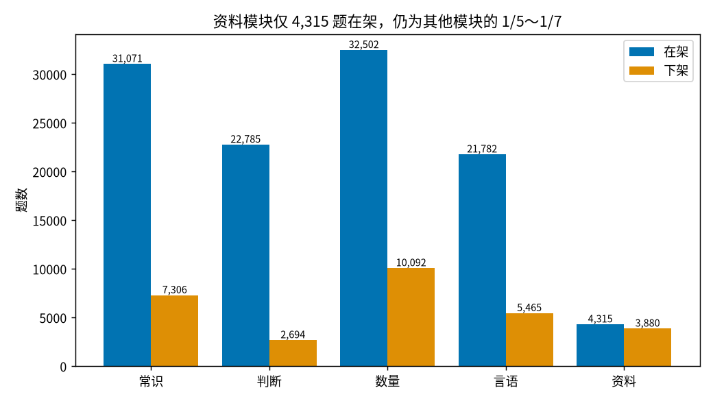
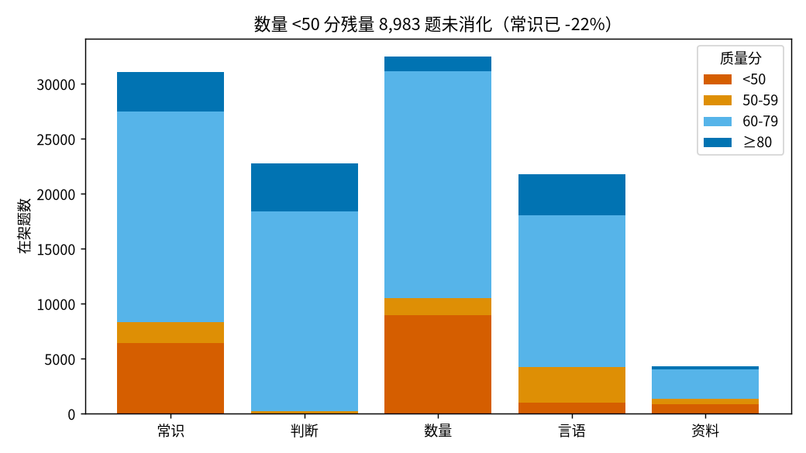
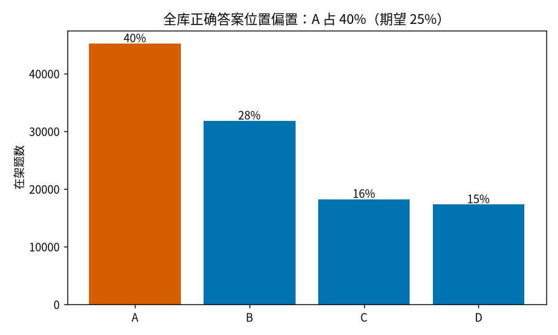
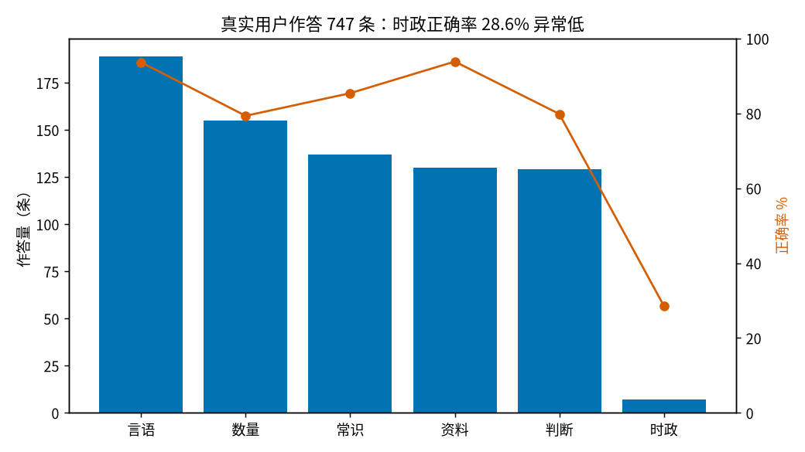
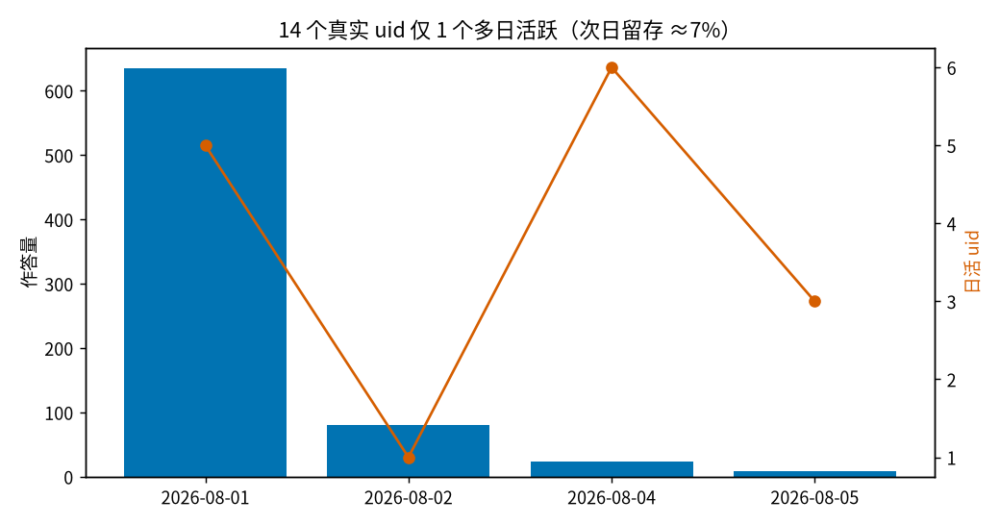
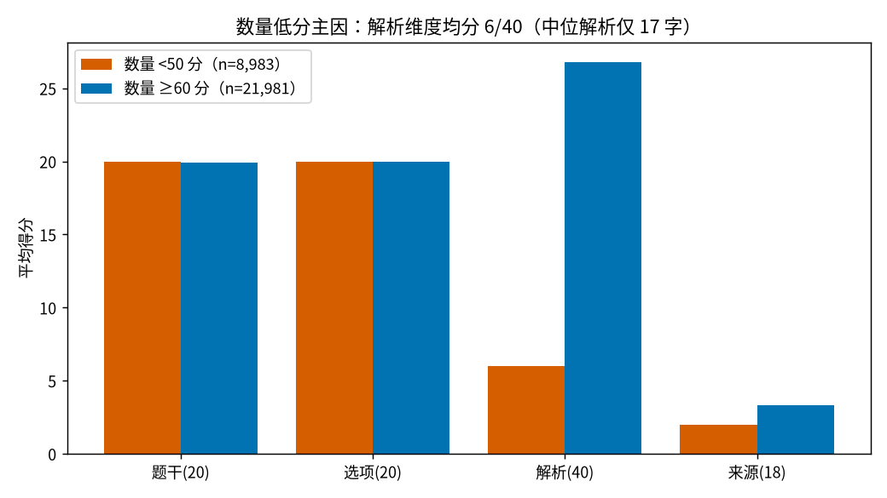

# 数据分析报告 · Round 2

- 数据源：轮1治理后生产库快照 `snap_r2.db`（2026-08-06，只读分析，不改生产）
- 分析口径：「在架」= `disabled=0`；「真实用户」= `uid LIKE 'ums%'`（排除 r68*/r74*/r81*/r88b*/opponent*/u_smoke 等测试 uid，测试流量占 answer_log 的 36.4%，427/1,174 条）
- 复现脚本口径与轮1一致（推荐重放复用 `backend/app/db.py` 的 `_score_skill` / `TAG3_MIN_N`）

---

## 0. 轮1治理效果复核（PR#54）

| 治理项 | 轮1前 | 本快照 | 结论 |
|---|---|---|---|
| tag3 UNKNOWN/空（在架） | 2 UNKNOWN | 2 UNKNOWN + 5 空 | ✅ 收敛（新增 5 空为治理后新导入题，见 P0-1） |
| submodule 空值（在架） | 常识 7,935 / 数量 7,455 | 常识 0 / 数量 0 / 言语 2 | ✅ 回填生效 |
| mistakes.question_id 缺失 | 64/102（63%） | 1/113（0.9%） | ✅ 回填生效（新增 1 条缺失来自新写入路径） |
| source 原始路径（github/.pdf） | 21,350 行 | 0 | ✅ 清零 |
| 在架页码残留（`- 17 -` 类） | 存在 | 0 | ✅ 清零 |
| 嵌套 ASCII 引号 | 存在 | 0（残留为中文引号嵌套 `“‘…’”`，不再是 ASCII 噪声） | ✅ 基本清零 |
| 常识 <50 分 | 8,229 | 6,423 | ✅ -22%，与轮1快照副本预测一致 |
| 数量 <50 分 | 8,983 | 8,983 | ⚠️ 未消化（轮1已预告，主因见 §4） |
| dup_clusters pending | 0 | 0（resolved 9,262 / not_dup 2,658） | ✅ 保持收敛 |
| 下架 | +182 | 生效（数量下架 10,092、资料 3,880） | ✅ |

轮1治理整体生效且无回退。**残余两大块：数量 8,983 题低分簇（原样未动）+ 常识 6,423 题低分簇（清洗后仍 <50）**，两者合计占全库 <50 分题的 94%。

---

## 1. 题库健康看板

### 1.1 各模块在架/下架

| 模块 | 在架 | 下架 | AI 生成占比（在架） |
|---|---|---|---|
| 常识 | 31,071 | 7,306 | 88.0% |
| 判断 | 22,785 | 2,694 | 78.2% |
| 数量 | 32,502 | 10,092 | 94.5% |
| 言语 | 21,782 | 5,465 | 79.2% |
| 资料 | **4,315** | 3,880 | 93.4% |
| 合计 | 112,455 | 29,437 | — |

**资料分析失衡未改善**（轮1 P0-1 提出补题，本快照在架反而 -4 题）。资料仍是真实用户作答第 4 大模块（130 条、正确率 93.8%），供需缺口最大。

### 1.2 tag3 / submodule 覆盖

- 在架 tag3 覆盖 99.994%：残余 2 题 UNKNOWN + **5 题 tag3/quality_score 双空**（id 1404077/1404211/1405098/1405449/1407396，均为治理后新导入的 `original` 题，`import_batch` 为空）→ 暴露**新题入库管线未挂 tag3 分类与质量打分**，详见 P0-1。
- submodule 空值：常识/数量清零，言语残余 2 题（即上述新导入题）。

### 1.3 质量分分布

| 模块 | <50 | 50-59 | 60-79 | ≥80 | <60 占比 |
|---|---|---|---|---|---|
| 常识 | 6,423 | 1,924 | 19,112 | 3,612 | 26.9%（轮1 27.9%）|
| 判断 | 61 | 182 | 18,136 | 4,406 | 1.1% |
| 数量 | 8,983 | 1,535 | 20,660 | 1,321 | 32.4%（持平）|
| 言语 | 1,001 | 3,256 | 13,814 | 3,709 | 19.5% |
| 资料 | 869 | 473 | 2,711 | 262 | 31.1% |

### 1.4 低分题 TOP

在架最低分仍是常识-历史人文 37-40 分批次（id 568091 等），特征从 ASCII 引号噪声变为**中文引号嵌套 `“‘官渡之战’”` + 无解析结构 + 无元数据**——文本清洗到位后分数未回升，说明该簇剩余失分在解析与元数据维度（同 §4 数量分析），不是继续洗文本能解决的。

### 1.5 图片引用健康

在架带图 216 题全部为相对路径 `/qimg/*.png`，无外链/data URI；资料模块在架无「引用图表但缺图」题。健康。

### 1.6 重复簇

`dup_clusters` 11,920 行：resolved 9,262 / not_dup 2,658 / **pending 0**。持续收敛。

### 1.7 新发现：全库答案位置偏置

在架题正确答案 A 占 **40.2%**（45,176/112,446，期望 25%），D 仅 15.4%。轮1治理（R78/R79）曾以「全批答案 90% 为 A」为整批驳回依据，但存量在架题的 A 偏置从未全库处理。用户可利用「蒙 A」策略使正确率虚高，也会污染正确率/弱项统计。

---

## 2. 作答数据分析

快照期 8/1–8/5（与轮1同窗口，新增仅 13 条），结论与轮1一致，更新如下。

### 2.1 作答量与正确率（真实用户 747 条 / 14 uid）

| 模块 | 作答量 | 正确率 |
|---|---|---|
| 言语 | 189 | 93.7% |
| 数量 | 155 | 79.4% |
| 常识 | 137 | 85.4% |
| 资料 | 130 | 93.8% |
| 判断 | 129 | 79.8% |
| 时政 | 7 | **28.6%** |

80% 作答来自单一 uid（`umsa00d6…` 595 条、正确率 95.1%），样本代表性有限。

### 2.2 错题热点考点 TOP20（n≥3）

| tag3 | 作答 | 错 | 错误率 | | tag3 | 作答 | 错 | 错误率 |
|---|---|---|---|---|---|---|---|---|
| PD-DY-01 单定义 | 25 | 6 | 24% | | CS-LS-04 文学艺术 | 14 | 3 | 21% |
| PD-LB-04 对应关系 | 30 | 6 | 20% | | SL-TC-02 容斥 | 4 | 2 | 50% |
| PD-LB-02 逻辑关系 | 8 | 5 | **63%** | | CS-KJ-02 科技 | 6 | 2 | 33% |
| CS-LS-01 中国古代史 | 16 | 5 | 31% | | SL-JS-07 计算 | 7 | 2 | 29% |
| YY-LJ-02 成语辨析 | 32 | 4 | 13% | | PD-LJ-06 逻辑 | 11 | 2 | 18% |
| SL-JS-01 基础代数 | 7 | 3 | **43%** | | SL-JH-01 几何 | 12 | 2 | 17% |
| ZL-JQ-01 基期量 | 9 | 3 | 33% | | CS-KJ-05 科技 | 13 | 2 | 15% |
| SL-PL-01 排列组合 | 10 | 3 | 30% | | SL-PL-07 概率 | 13 | 2 | 15% |
| PD-LJ-05 加强论证 | 11 | 3 | 27% | | YY-JB-01 病句 | 14 | 2 | 14% |
| SL-JJ-01 经济利润 | 12 | 3 | 25% | | YY-XJ-01 选词 | 15 | 2 | 13% |

类比推理（PD-LB-02/04）、单定义（PD-DY-01）仍是最集中错误热点；错题本（mistakes 回填后 106/113 可 join tag3）热点与之吻合（PD-DY-01 居首）。

### 2.3 模考完成率

exam_attempts 7 次（+1），提交 3 次，完成率 43%；已提交得分 6.7 / 3.3 / 1.3 分。**得分极低更可能是「非认真作答/体验问题」而非能力问题**——建议在提交里记录每题用时以区分。

### 2.4 活跃与留存

14 个真实 uid 中仅 1 个出现 ≥2 天（次日留存 ≈7%），与轮1持平；8/4 日活 6 人为峰值但人均 <4 题。产品当前瓶颈仍是留存而非题量。

---

## 3. 推荐与错题匹配度

方法同轮1：4 个作答 ≥20 的真实用户，前 70% 作答离线重放 `recommend_stats`（`_score_skill` + `TAG3_MIN_N=5`）生成 Top-4 推荐，检验后 30% 错题命中（tag3 或 module+submodule 命中均算）。

| uid | 作答 | 留出集错题 | 命中 |
|---|---|---|---|
| umsa00d6… | 595 | 6 | 1 |
| umsacie7… | 60 | 3 | 0 |
| umsafoov… | 25 | 5 | 0 |
| umsafpah… | 25 | 2 | 0 |
| 合计 | — | 16 | **1（6%）** |

比轮1（13%）更低，且发现**新的结构性问题**：

**answer_log.submodule 未随轮1 T3b 同义合并归一**。真实用户作答中 16%（113/712）的 submodule 已不存在于当前题库（如「片段阅读→中心理解」「基期量→基期与现期」「增长问题→增长率」「地理→地理国情」「盈亏问题→计算问题」）。重放结果里推荐项直接输出「隔年增长」「现期量」「语句排序」等旧名——这些推荐点按新 taxonomy 无法关联到练习题，弱项统计也被切碎（同一考点被新旧两名各算一份，均难达 `TAG3_MIN_N`）。

---

## 4. 数量模块低分主因量化

按打分器（`backend/app/quality.py`）四个维度分解数量模块在架题均分：

| 维度（满分） | <50 分簇（n=8,983） | ≥60 分（n=21,981） |
|---|---|---|
| 题干完整性（20） | 20.0 | 19.9 |
| 选项完整性（20） | 20.0 | 20.0 |
| **解析（40）** | **6.0** | 26.8 |
| 来源可信度（18 实际上限） | 2.0 | 3.3 |

低分簇特征 100% 命中：`source='original'`（100%）、解析 <80 字（100%，中位 **17 字**）、无任何结构线索词（因此/所以/故选/步骤…100%）、无 hs_explanation（100%）、无 exam_year/exam_region（100%）。**低分完全由「解析缺失结构与长度 + 缺考试元数据」构成，题干/选项本身完好** ——即轮1报告的判断得到精确量化证实。

分布：计算问题 2,225、排列组合与概率 1,440、几何 1,285、行程 831、容斥 716、最值 706……（TOP10 占 97%）。

轮1 T2 LLM 解析改写 10,541 题**全部在常识模块，数量 0 题**——直接结论：把 T2 同款两阶段管线（改写+独立作答二审）扩到数量 8,983 题即可按同样路径消化（常识实测 <50 分 -22%，数量解析权重占比更高，预期消化率更高）。

---

## 5. LLM 改写题抽样质量审计（ledger method=llm）

对 `data/iter-r1/ledger.jsonl` 中 T2 `action=fix`（10,541 题，method=llm(deepseek)，全部常识）审计：

**人工抽样复核（随机 12 题，seed=42）**：12/12 答案正确、解析事实无误且含排错说明，无元评论/引号残留。改写质量合格。

**全量自动化指标（在架 10,541 题）**：

| 指标 | 值 | 评价 |
|---|---|---|
| 答案字母分布 | A 27.8% / B 25.8% / C 24.0% / D 22.4% | ✅ 无偏置（对比全库 A 40.2%） |
| 解析 <40 字 | 27（0.3%） | ✅ |
| 改写后仍 <60 分 | 4,470（42%） | ⚠️ 失分在缺元数据/无 hs，非解析本身 |
| **正确项为最长选项（≥1.5× 第二长）** | **6,819（64.7%）** | ⚠️ 答案泄漏：轮1「替换过弱干扰项」将正确项写成完整描述句、干扰项保持短词 |
| 模板化题干（`…之X是：`类） | 3,226（30.6%） | ⚠️ 题干不自然（如「白沙之学的静中之悟是」「吐鲁番的赤砂之炎是」），属旧生成器残留，改写未触碰题干 |

结论：LLM 改写在**答案正确性与解析质量上可信**，但暴露两个可量化的残余风险——正确项长度泄漏（64.7%）与模板化题干（30.6%），应列入下轮治理。

---

## 6. 数据驱动的改进点

### P0-1 堵住新题入库管线缺口（tag3/质量分/审核旁路）
治理后新导入的 5 题（id 1404077 等）无 tag3、无 quality_score、无 import_batch，直接在架。轮1花 5.6 万条台账治理存量，若入库管线不挂「分类→打分→抽检」钩子，脏数据会持续回流。**修复点：导入接口强制走 score_quality + tag3 分类，未过线进待审而非直接 disabled=0。**

### P0-2 回填/归一 answer_log.submodule 旧名（推荐链路正确性）
16% 真实作答的 submodule 是轮1合并前旧名，推荐输出旧名考点无法关联练习题，弱项统计被新旧名切碎（§3 命中率 6% 的直接原因之一）。**修复点：按 T3b 同一 alias 映射批量 UPDATE answer_log（一次性 SQL），并在写入路径统一从 questions 表取 submodule 而非前端透传。**

### P1-1 数量模块 8,983 题解析重写（T2 管线扩展）
低分主因已精确量化（§4：解析 6/40 分、中位 17 字、100% 无结构）。复用轮1 T2 两阶段管线（deepseek 改写 + 独立作答二审），按 TOP 子模块（计算/排列组合/几何/行程）分批执行；数量题可加「代入验算」第三重校验（让模型代入选项数值验证）。预期把数量 <60 占比从 32.4% 压到 ~10%。

### P1-2 全库答案位置偏置治理（A 40.2%）
对 AI 生成题（is_real=0）批量随机重排选项顺序（同步改 answer 字母与解析中的字母引用），把 A 占比拉回 ~25%。优先处理常识/数量（AI 占比 88%/94.5%）。这同时消除「蒙 A」导致的正确率虚高，让 §2 的正确率与弱项统计可信。

### P1-3 LLM 改写残余风险收口：正确项长度泄漏 + 模板化题干
§5：T2 改写题 64.7% 正确项为最长选项、30.6% 题干模板化。**修复点：a) 对泄漏题让 LLM 把干扰项扩写为同长度的完整表述（保持错误性）；b) 模板化题干（`…之X是`3,226 题）批量改写为自然问句。** 两者均可用 ledger 定位精确题集，成本可控。

### P2-1 推荐冷启动与资料补题（延续轮1 P0-1/P2-1，未落地）
资料在架 4,315 题、供需缺口最大但轮1后零增长；推荐命中率 6% 且 `TAG3_MIN_N=5` 对中位作答 ~5 题的用户仍不可达。维持轮1建议：作答 <30 时 TAG3_MIN_N 降为 3 + 以实际错过的考点为种子；补题优先资料分析热点考点（ZL-JQ-01 基期量等）。

### P2-2 模考与留存埋点补齐
模考完成率 43%、提交分 1.3-6.7 分无法区分「弃考/乱点/太难」；answer_log 无 session 概念难以算真实留存。建议 exam_attempts 记每题用时、answer_log 增加 client/session 字段，为下轮留存分析提供数据。

---

## 附：图表与复现

| 文件 | 内容 |
|---|---|
| chart-module-counts.png | 各模块在架/下架题数 |
| chart-quality-dist.png | 质量分分布（按模块） |
| chart-shuliang-lowscore.png | 数量低分簇四维度失分分解 |
| chart-answer-letter-bias.png | 全库正确答案位置分布 |
| chart-answers-by-module.png | 真实用户作答量与正确率 |
| chart-daily-activity.png | 日作答量与日活 |

分析脚本（只读，快照本地执行）：题库看板/复核 SQL、低分分解（复算 `quality.score_question` 四维度）、ledger 审计（随机抽样 seed=42/7）、推荐重放（复用 `db._score_skill`、70/30 切分）。
